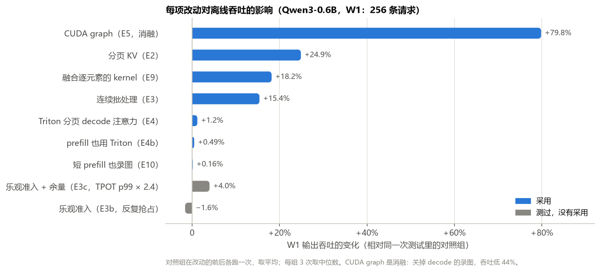
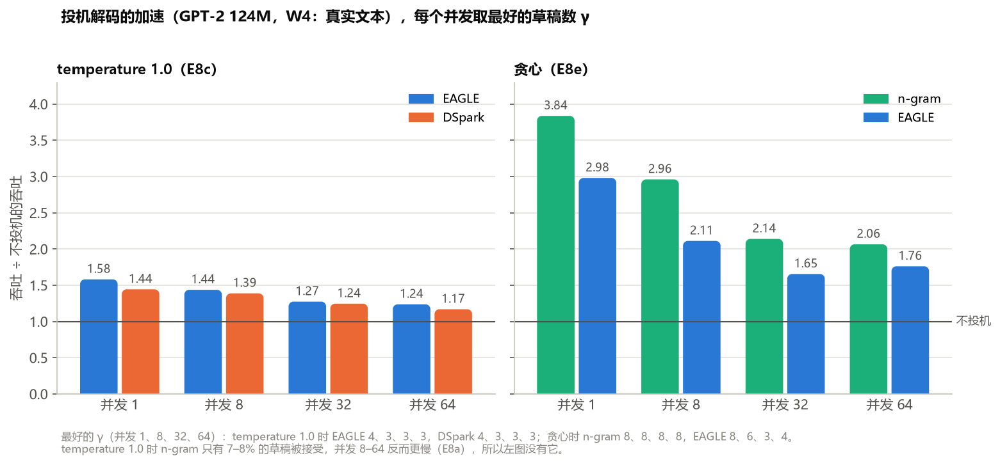
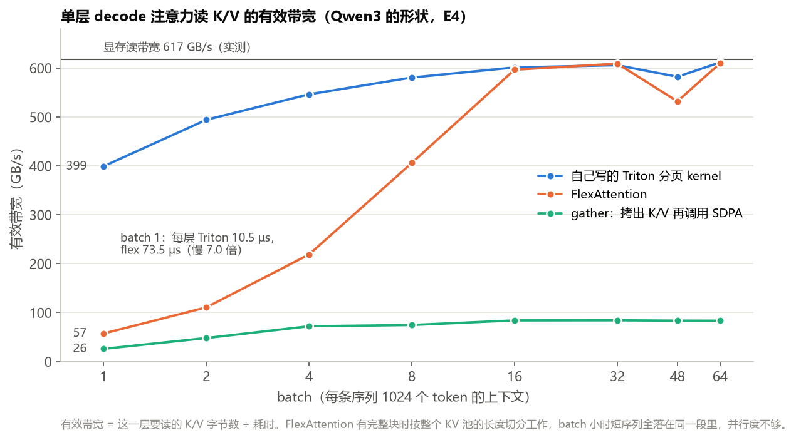

# mini-vllm：在一张笔记本 GPU 上从零写一个 LLM 推理引擎

参照 vLLM 的设计，从零写一个小型的 LLM 推理引擎，在一张 12 GB 的笔记本 RTX 5070 Ti 上服务 Qwen3-0.6B。分页 KV、连续批处理、注意力 kernel、CUDA graph、投机解码和 HTTP 服务都是自己实现的。每次只改一处，逐项测量它对吞吐和延迟的影响。

- **离线吞吐：** 256 条请求（W1）从 1760 提高到 3215 输出 token/s，是 HF transformers 静态批处理（160 token/s）的 20 倍。
- **在线延迟：** 请求陆续到达、负载不超过处理能力时（W2），首 token 延迟的中位数从静态批处理的 3.5–6.5 秒降到约 40 ms；分块 prefill 让 ITL 的 p99 再降低 41–50%。
- **投机解码（GPT-2 124M）：** 自己训练的 EAGLE 式草稿模型，在 temperature 1.0 时让吞吐提高 24–58%；贪心时，n-gram 起草让吞吐提高到 2.1–3.8 倍。
- **服务：** OpenAI 兼容的 HTTP 接口，支持流式输出。引擎跑在独立的进程里，和直接调用引擎相比，每个 token 只慢 0.08–0.23 ms。

每个实验的设置、对照、波动和分析都在 [EXPERIMENTS.md](EXPERIMENTS.md)，原始数据在 [results/](results/)。

## 结果

**离线吞吐**（W1：256 条请求同时到达，prompt 和输出都是 100–1024 个 token，共输出 146,005 个 token）：

| | HF transformers | 起点（E1） | 最终（E10） |
|---|---|---|---|
| 输出吞吐 | 160 token/s | 1760 token/s | **3215 token/s** |
| 同时运行的序列（平均 / 最多） | 24 / 24 | 18.8 / 32 | 47.1 / 60 |
| KV 利用率 | — | 52.1% | 99.2% |
| 显存峰值 | 6.77 GiB | 8.61 GiB | 8.60 GiB |

- **HF transformers：** `generate`，静态批处理，batch 24（能跑完 W1 的最大 batch）。
- **起点：** 自己的引擎，每条序列按最大长度预留一块连续的 KV（相当于静态 KV cache），静态批处理；decode 已经录了 CUDA graph。
- **最终：** 分页 KV、连续批处理、自己写的 Triton 分页注意力、融合的逐元素 kernel，短 prefill 也录图。



每个百分比都是和同一次测试里的对照组比的，对照组在改动的前后各跑一次。同一个配置在不同的测试里可以差 4%，所以不同测试的吞吐不直接相减。

## 做了哪些改动

**引擎**（Qwen3-0.6B）：

| 改动 | 结果 | 采用 |
|---|---|---|
| 分页 KV（E2） | KV 利用率从 52% 提高到 99%，一批能放的序列从 32 条变成最多 60 条，吞吐 +24.9% | 是 |
| 连续批处理（E3） | 吞吐 +15.4%；在线时首 token 延迟的中位数从 3.5–6.5 秒降到约 40 ms | 是 |
| 乐观准入：不预留，块不够时抢占（E3b） | 反复抢占 191 次，吞吐 −1.6% | 否 |
| 乐观准入加余量（E3c） | 吞吐比预留高 4.0%，但 TPOT 的 p99 变成 2.4 倍 | 否 |
| 自己用 Triton 写分页注意力（E4、E4b） | 单层 decode 注意力在 batch 1–8 时比 FlexAttention 快 1.4–8.1 倍，低负载的在线 TPOT 降低 19–26%；W1 上只 +1.2%、+0.49% | 是 |
| decode 录 CUDA graph（E5，消融） | 关掉以后吞吐 −44%，batch 1 每步从 5.0 ms 变成 31.2 ms | 是 |
| 前缀缓存（E6） | 共享前缀的负载（W3）离线总耗时从 5.8 秒降到 2.3 秒，在线每秒 32 条时 TTFT 的 p99 从 1.46 秒降到 65 ms | 可选 |
| 分块 prefill（E7） | ITL 的 p99 降低 41–50%，最长的停顿从 91–138 ms 降到 25–29 ms；预算太大时，补齐反而让它变差 | 可选 |
| 融合逐元素的 kernel（E9） | decode 图的 kernel 从 1525 个降到 282 个，吞吐 +18.2% | 是 |
| 短 prefill 也录 CUDA graph（E10） | GPT-2 的 prefill 步快 21–36%；W1 不变 | 是 |
| OpenAI 兼容的 HTTP 服务（E11、E11b） | 引擎放在服务进程的一个线程里，每个 decode 步多约 0.2 ms（GIL）；放进独立进程以后，TPOT 只多 0.08–0.23 ms | 独立进程 |

**投机解码**（GPT-2 124M，W4：FineWeb-Edu 的真实文本）：

| 改动 | 结果 |
|---|---|
| n-gram 起草（E8a） | 贪心时吞吐提高到 1.53–3.64 倍（84–86% 的输出能照抄前文）；temperature 1.0 时只有 7–8% 的草稿被接受，并发 8–64 反而慢 10–15% |
| EAGLE 式草稿模型（E8b） | 一层 GPT-2 block，读目标模型的特征起草，训练 42 分钟；temperature 1.0 时并发 1–8 快 22–28% |
| 接受判断融合成两个 kernel（E8b.1） | 接受判断快 2.8–9.0 倍，EAGLE 的吞吐再提高 14–19% |
| 起草的输入在 GPU 上准备（E8b.2） | 起草每步少 0.29–0.43 ms，吞吐再提高 3–10% |
| DSpark 式并行起草（E8c） | 一次前向起草一整段，起草的时间省 31–44%；但接受率低，每步的 token 少 14–19%，比 EAGLE 慢 2–9% |
| 每个草稿的采样合成一个 kernel（E8c.1） | 起草每步少 0.06–0.18 ms，吞吐提高 1.1–6.9% |
| 两层的 DSpark 草稿（E8c.2） | 每步多 0.11–0.15 个 token，但每步也慢 0.10–0.30 ms，没有收益 |
| 按置信度选验证长度（E8d） | 离线估计以后没有做：信号分不开会被接受和会被拒绝的草稿（AUC 0.63–0.67） |
| 贪心时重比 n-gram 和 EAGLE（E8e） | EAGLE 每步的 token 更多，但起草要花时间，仍比 n-gram 慢 15–29% |



## 几个发现

1. **小模型 decode 时，瓶颈常常是 CPU 提交 kernel。** 不录 CUDA graph 时，Qwen3-0.6B batch 1 的 decode 每步 31.2 ms，录图以后是 5.0 ms。录图以后，每层的 norm、RoPE、写 KV、残差相加这些逐元素运算合成 5 个 Triton kernel（E9），decode 图从 1525 个 kernel 降到 282 个，W1 又快了 18%；大 prefill 时，这些小运算的 GPU 时间原来比全部矩阵乘还长。
2. **FlexAttention 在小 batch 时慢，原因在它切分工作的方式。** mask 里有完整块时，它按整个 KV 池的长度切分，短序列全落在同一段里，batch 1 时只用到 57 GB/s。自己写的 Triton kernel 按序列、KV 头和一段上下文分工（FlashDecoding），段长随 batch 调整，batch 1 时 399 GB/s，快 7.0 倍。batch ≥ 16 时两者都接近显存带宽，所以 W1（decode batch 约 46）上只快 1.2%，收益在低负载的在线服务上。

   

3. **不预留 KV 的乐观准入会反复抢占同一条序列。** 被抢占的序列放回队首，下一步就用它刚让出的块重新进入；它又是最后进入的那条，块再不够时又被抢占，有的被抢占了 9 次，吞吐反而低 1.6%。给每条运行中的序列留一个空闲块以后，抢占从 191 次降到 42 次，吞吐比预留高 4.0%，但 TPOT 的 p99 变成 2.4 倍，所以没有采用。
4. **分块 prefill 的预算不是越大越好。** 混合步的 token 数要补齐到 2 的幂才能录图。预算 2048 时，一步刚过 1024 个 token 就要补到 2048，每秒 8 条时 ITL 的 p99 反而比不分块差 20–23%；预算 512 时降低 41–50%。
5. **怎么起草，要看输出。** 124M 的模型贪心时 84–86% 的输出能照抄前文，n-gram 不花时间就能猜中，最快（并发 1 时 3.84 倍）；正常采样时 n-gram 几乎猜不中，要用训练出来的草稿。DSpark 式的并行起草省下了 31–44% 的起草时间，但在这个规模上，接受率的损失更大。
6. **HTTP 服务要把引擎放进独立的进程。** 引擎在服务进程的一个线程里时，它每一步的 Python 代码要和事件循环轮流拿 GIL：扣掉 batch 变大的影响，每个 decode 步多约 0.2 ms，低负载时 TPOT 长 9–10%。和 vLLM V1 一样放进独立的进程以后，只多 0.08–0.23 ms。

## 实验方法

- **负载：**
  - W1：256 条请求，prompt 是随机 token，prompt 和输出都是 100–1024 个 token，忽略 EOS，同时到达。和 nano-vllm 的基准测试相同。
  - W2：W1 的请求按泊松过程陆续到达，每秒 1、2、4、8 条。
  - W3：64 条请求共用一段 1000 个 token 的前缀。
  - W4：GPT-2 用，prompt 是 FineWeb-Edu 验证集里 256 篇文档的开头。随机 token 测不出真实的接受率。
- **对照：** 每次只改一处。对照组在同一次测试里、改动的前后各跑一次，变化相对两次的平均。
- **重复：** 离线吞吐每种配置预热以后跑 3 次，取中位数。
- **正确性：** Qwen3 对比 HF transformers，GPT-2 对比 nanoGPT；录图和不录图、投机和不投机（贪心）生成的 token 逐个相同；拒绝采样以后，输出的分布和目标分布一致（按频率检查）。
- **记录：** 没有提升的实验也照样记录，见 EXPERIMENTS.md。

## 运行

环境：Windows 11，Python 3.11，PyTorch 2.11（CUDA 12.8），triton-windows 3.6.0.post26（Linux 上用 PyTorch 自带的 Triton）。

```bash
pip install torch --index-url https://download.pytorch.org/whl/cu128
pip install -r requirements.txt
pip install -U "triton-windows<3.7"   # 只有 Windows 需要

# Qwen3-0.6B 的权重
hf download Qwen/Qwen3-0.6B --local-dir checkpoints/Qwen3-0.6B

# 正确性
python -m tests.test_qwen3_hf   # 前向对比 HF transformers
python -m tests.test_server     # HTTP 服务
python -m tests.test_engine     # 引擎；也测 GPT-2，需要下面说的 checkpoint

# W1 离线吞吐（默认就是最终的配置）、W2 在线延迟
python -m bench.bench_offline --out results/w1.json
python -m bench.bench_online --rates 1 2 4 8 --out results/w2.json

# OpenAI 兼容的 HTTP 服务
python -m minivllm.server --port 8000
curl http://127.0.0.1:8000/v1/chat/completions -H "Content-Type: application/json" \
  -d '{"messages": [{"role": "user", "content": "Name three colors."}], "max_tokens": 64, "chat_template_kwargs": {"enable_thinking": false}}'
```

- **GPT-2 的实验（E8）：** 用 nanoGPT 项目（[Homwayy/nanoGPT](https://github.com/Homwayy/nanoGPT)）训练的 checkpoint 和它准备的 FineWeb-Edu 数据，路径写在 [minivllm/model_runner.py](minivllm/model_runner.py) 的 `MODELS` 和 [train_draft.py](train_draft.py) 的 `DATA` 里。草稿模型用 `python train_draft.py --out checkpoints/gpt2_eagle.pt --log eagle_train.json` 训练；投机解码的基准测试，例如 `python -m bench.bench_spec --spec eagle --num-spec-tokens 4 --temperature 1.0 --out results/w4_eagle.json`。
- **画图：** `python figures/plot.py`，数据都从 results/ 读。

## 目录

| 路径 | 内容 |
|---|---|
| [minivllm/engine.py](minivllm/engine.py) | 引擎：加入请求，每一步调度、跑模型、采样、更新序列 |
| [minivllm/scheduler.py](minivllm/scheduler.py) | 调度：静态和连续批处理、抢占、分块 prefill |
| [minivllm/kv_manager.py](minivllm/kv_manager.py) | KV 池：连续和分页的分配、三种准入方式、前缀缓存 |
| [minivllm/model_runner.py](minivllm/model_runner.py) | 每一步的输入布局和 CUDA graph（decode 按 batch 分桶，混合步按 token 数分桶） |
| [minivllm/attention/](minivllm/attention/) | 注意力：Triton 分页 kernel（prefill 和 decode）、FlexAttention、gather |
| [minivllm/fused.py](minivllm/fused.py) | 融合逐元素运算的 Triton kernel |
| [minivllm/models/](minivllm/models/) | 自己写的 Qwen3 和 GPT-2 前向 |
| [minivllm/spec/](minivllm/spec/) | 投机解码：n-gram、EAGLE 和 DSpark 的起草，拒绝采样的 kernel |
| [minivllm/server.py](minivllm/server.py)、[async_engine.py](minivllm/async_engine.py)、[tokenizer.py](minivllm/tokenizer.py) | OpenAI 兼容的 HTTP 服务、独立的引擎进程、增量解码 |
| [train_draft.py](train_draft.py)、[train_dspark.py](train_dspark.py) | 训练 EAGLE 和 DSpark 的草稿模型 |
| [bench/](bench/) | 负载（[bench/workloads/](bench/workloads/)）和所有基准测试脚本 |
| [tests/](tests/) | 正确性测试 |
| [results/](results/) | 每个实验的原始结果（JSON） |
| [figures/](figures/) | 画图脚本 `plot.py` 和生成的图 |
| [EXPERIMENTS.md](EXPERIMENTS.md) | 完整的实验记录 |

设计参考了 [vLLM](https://github.com/vllm-project/vllm) 和 [nano-vllm](https://github.com/GeeeekExplorer/nano-vllm)；草稿模型参考了 [EAGLE](https://arxiv.org/abs/2401.15077) 和 DSpark（arXiv 2607.05147）。
